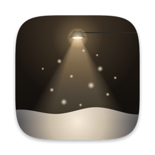
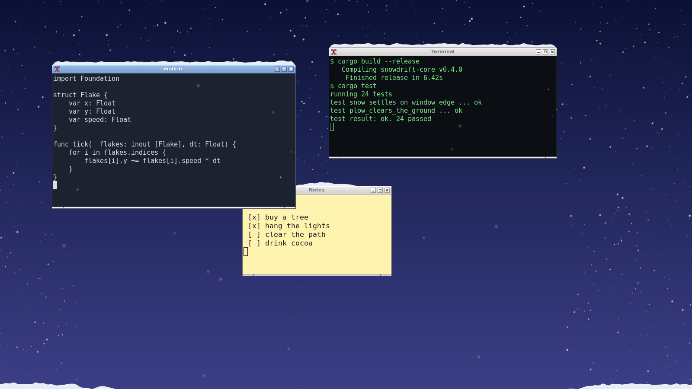
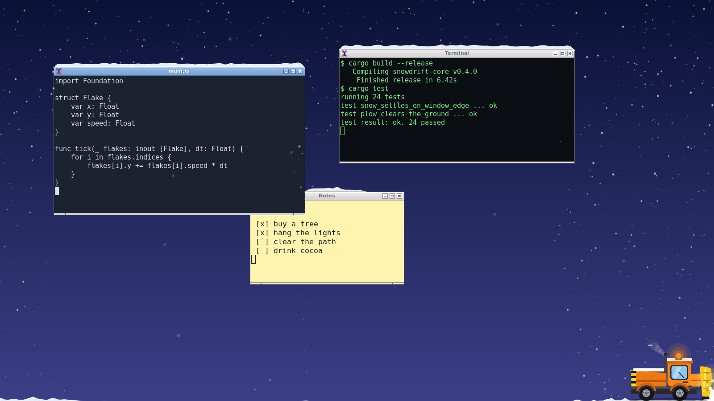
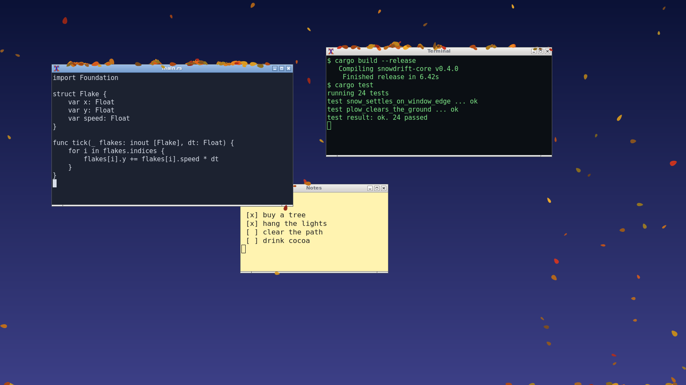
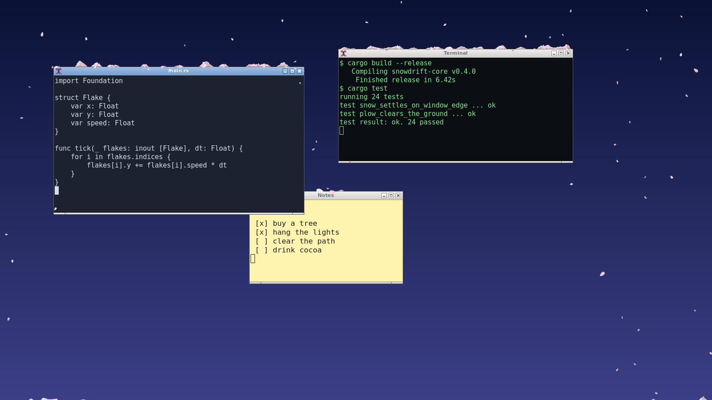

<div align="center">



# Snowdrift

**Снегопад поверх всех окон на macOS, Windows и Linux.**
Снег ложится на кромки окон, сползает вместе с ними, а когда сугробы вырастают, выезжает снегоуборщик.

*Snowfall for macOS, Windows and Linux: snow piles up on your windows, slides off when you move them, and a snowplow clears the pile.*

[](https://github.com/LerkOFF/snowdrift/releases/latest)
[](LICENSE)


[](https://github.com/LerkOFF/snowdrift/releases)

[Установка](#установка) · [Возможности](#возможности) · [Режимы](#режимы) · [Управление](#управление) · [Сборка](#сборка-из-исходников)

<br>



</div>

<br>

Клики проходят сквозь снег, значка в Dock нет, управление живёт в меню-баре (macOS), системном трее (Windows) или командной строке (Linux).

## Возможности

| | |
|---|---|
| ❄️ **Живой снег** | Снежинки с глубиной и разной плотностью: от лёгкого снегопада до метели |
| 🪟 **Сугробы на окнах** | Снег ложится на верхнюю кромку каждого окна, двигается вместе с ним, рывок стряхивает часть, закрытое окно осыпается целиком |
| 🚜 **Снегоуборщик** | Когда внизу много снега, выезжает вдоль нижнего края, сгребает его в вал и сбрасывает за край экрана. Вызвать можно и вручную |
| 🖱️ **Курсор** | Разгребает сугроб и поднимает снежную пыль. Над Dock или панелью задач снег разлетается в стороны |
| 🗂️ **Панели внутри окон** | По желанию: диалоги, всплывающие окна и большие картинки получают свой сугроб |
| 🎄 **Новый год** | Гирлянда на верхней кромке окон, снеговик, которого лепишь сам (скатай ком из снега на земле, перенеси и поставь друг на друга), иней по краям экрана, который стирается курсором. Меню «Новый год», пункт «Всё сразу» |
| 🍂 **Пять режимов** | Снег, осенние листья, дождь, сакура и Хэллоуин |
| ⚙️ **Настройки** | Плотность, прозрачность, таяние, скрытие от скриншотов, запуск при входе в систему |
| 🌍 **Девять языков** | Интерфейс следует за языком системы (macOS и Windows) |

<details>
<summary><b>Как работают панели внутри окон</b></summary>

<br>

Положение панелей берётся у специальных возможностей системы. На macOS нужно разрешение «Универсальный доступ», на Windows работает через UI Automation, на Linux через шину AT-SPI (`snowdrift set panels on`). Что приложение не показывает системе, снега не получит.

</details>

## Снегоуборщик

<div align="center">

</div>

Снегоуборщик прорисован вручную: кабина, бункер, отвал с резиновой кромкой, вращающиеся колёса, дым и мигалка. Он гребёт снег перед ковшом и сбрасывает его за край экрана.

## Новый год

Три украшения, каждое включается отдельно (меню «Новый год» на macOS и Windows, `snowdrift set garland|snowmen|frost on` на Linux) или все сразу (`snowdrift set newyear on`).

- **Гирлянда.** Лампочки висят провисающим шнуром вдоль верхней кромки окна и мерцают. Если окно закрыто другим, гирлянда за ним не видна. Когда включена гирлянда, снег на окнах можно выключить: окна останутся только с лампочками.
- **Снеговик.** Нажми на сугроб внизу экрана и тяни вдоль земли: снег под курсором сворачивается в ком, и чем дальше катишь, тем он больше. Ком можно поднять, перенести и поставить на другой. Три кома друг на друге, от большого к маленькому, получают лицо, нос-морковку, пуговицы, шарф и руки-ветки. Слишком резкий бросок разбивает ком, снегоуборщик сметает снеговиков. «Убрать снеговиков» в меню (или `snowdrift snowmen clear`) разбивает всех.
- **Иней.** От углов и середин краёв экрана за несколько минут растут папоротниковые узоры. Курсор протирает чистые полосы, иней замерзает там снова за минуту. Скорость роста можно изменить переменной `SNOWDRIFT_FROST_SECONDS`.

Пока курсор над комом снега или несёт его, поверх экрана ловятся клики: в остальное время мышь работает как обычно.

## Режимы

<table>
<tr>
<td align="center" width="50%"><br><b>Осень</b></td>
<td align="center" width="50%"><br><b>Сакура</b></td>
</tr>
</table>

Ещё есть дождь и Хэллоуин. Кадры сняты в Linux-версии на виртуальном экране с тестовыми окнами.

## Установка

Нужна macOS 13 или новее, Windows 10 или новее, либо Linux с X11 или XWayland и композитором.

<details open>
<summary><b>macOS</b></summary>

<br>

```bash
curl -fsSL https://raw.githubusercontent.com/LerkOFF/snowdrift/main/install.sh | bash
```

Приложение ставится в `~/Applications/Snowdrift.app` и сразу запускается. Другая папка: `SNOWDRIFT_DIR=/Applications`.
Удалить: `curl -fsSL https://raw.githubusercontent.com/LerkOFF/snowdrift/main/install.sh | bash -s -- --uninstall`.

Apple Silicon или Intel. Можно и вручную: скачать `Snowdrift.zip` из [Releases](https://github.com/LerkOFF/snowdrift/releases/latest), распаковать и открыть. Приложение подписано без сертификата разработчика Apple, поэтому при ручной установке macOS при первом запуске спросит подтверждение: «Системные настройки, Конфиденциальность и безопасность, Всё равно открыть» (или правый клик по приложению, «Открыть»). Установка командой выше этого вопроса не вызывает.

</details>

<details>
<summary><b>Windows</b></summary>

<br>

В PowerShell:

```powershell
irm https://raw.githubusercontent.com/LerkOFF/snowdrift/main/install.ps1 | iex
```

Скрипт скачивает `Snowdrift.exe`, копирует его в `%LOCALAPPDATA%\Programs\Snowdrift`, добавляет ярлык в меню «Пуск» и запись в «Установку и удаление программ» и запускает. Права администратора не нужны.
Удалить: «Параметры, Приложения» или `& "$env:LOCALAPPDATA\Programs\Snowdrift\Snowdrift.exe" --uninstall`.

Windows 10 или новее, x64. Можно и вручную: скачать `Snowdrift.exe` из [Releases](https://github.com/LerkOFF/snowdrift/releases/latest) и запустить с ключом `--install`.

</details>

<details>
<summary><b>Linux</b></summary>

<br>

Одной командой (x86_64 и aarch64, под себя в `~/.local`, права root не нужны):

```bash
curl -fsSL https://raw.githubusercontent.com/LerkOFF/snowdrift/main/install.sh | bash
```

Или пакетом из [Releases](https://github.com/LerkOFF/snowdrift/releases/latest):

| Дистрибутив | Файл |
|---|---|
| Debian, Ubuntu, Mint | `snowdrift_<версия>_amd64.deb`, `snowdrift_<версия>_arm64.deb` |
| Fedora, openSUSE | `snowdrift-<версия>-1.x86_64.rpm`, `snowdrift-<версия>-1.aarch64.rpm` |
| любой другой | `Snowdrift-linux-<arch>.tar.gz`, бинарник собран статически |
| Arch | `linux/packaging/PKGBUILD` (на Arch не проверялся) |

**Что нужно:** сеанс X11 (Xorg) или Wayland с XWayland и **композитор**. В GNOME, KDE, Xfce, Cinnamon, MATE он уже есть; в i3, bspwm, dwm, qtile, openbox его нет, запустите `picom -b`. Без композитора программа скажет об этом и не запустится.

Тайловые менеджеры работают: рамки окон берутся у X-сервера, окна вплотную друг к другу снега на кромке не держат, зазоры между окнами (gaps) он использует. Панель внизу экрана (рабочая область) снег обходит, ложится на неё сверху.

**Ограничения:** в сеансе Wayland снег ложится только на окна приложений XWayland, окна родных Wayland-приложений сугробов не получают (Wayland не отдаёт положение чужих окон), а снег поверх них падает и накапливается на дне экрана. Значка в трее и Хэллоуина в Linux-версии пока нет.

</details>

## Управление

На macOS управление в меню-баре, на Windows в системном трее. На Linux программа ищется в меню приложений как «Snowdrift», действия (снегоуборщик, сдуть снег, выйти) есть в контекстном меню её ярлыка, а из терминала:

```bash
snowdrift start            # запустить в фоне (snowdrift run: в этом терминале)
snowdrift stop             # выйти
snowdrift plow             # вызвать снегоуборщик
snowdrift clear            # сдуть снег
snowdrift set intensity 70 # 0-100; ещё opacity, ground, melt, windows, fullscreen, panels, garland, snowmen, frost, newyear, mode snow|autumn|rain|blossom, mixed
snowdrift snowmen clear    # разбить всех снеговиков
snowdrift autostart on     # запускать при входе
snowdrift update           # проверить обновления, скачать, заменить и перезапустить
```

Обновление: на macOS и Windows пункт меню «Проверить обновления…» сам скачивает новую версию, заменяет приложение и запускает его заново (Windows ещё и раз в сутки сообщает о выходе новой версии). Настройки сохраняются.

Настройки лежат в `~/.config/snowdrift/config`. Удалить: `snowdrift uninstall` или `install.sh --uninstall`.

## Сборка из исходников

<details>
<summary><b>macOS, Windows, Linux</b></summary>

<br>

macOS (нужны Command Line Tools: `xcode-select --install`):

```bash
./build.sh                 # build/Snowdrift.app, arm64 и x86_64
open build/Snowdrift.app
```

Windows (Rust, из любой ОС, кросс-сборка через `cargo-xwin`):

```bash
cd windows
cargo xwin build --release --target x86_64-pc-windows-msvc --bin Snowdrift
```

Linux (Rust, нужен Docker, собирает статические бинарники и пакеты deb, rpm, tar.gz для x86_64 и aarch64):

```bash
./linux/build.sh           # dist/linux
```

</details>

Общая симуляция снега лежит в `core/` (Rust, `cargo test` в этой папке), версия в файле `VERSION`.

## Устройство

| Папка | Что внутри |
|---|---|
| `Sources/Snowdrift/` | macOS: Swift и Metal |
| `windows/` | Windows: Rust, Direct2D и D3D11 |
| `linux/` | Linux: Rust, x11rb, программный рендерер без GPU |
| `core/` | общее ядро симуляции на Rust с тестами |
| `locales/` | строки интерфейса на девяти языках |

## Лицензия

Код под MIT, см. [LICENSE](LICENSE).
